<!-- Every card is an animated SVG drawn by scripts/render_readme_cards.py and refreshed daily
     by .github/workflows/readme-cards.yml. Spacing is baked into the SVGs, so keep this block
     free of blank lines and keep each row of cards on one line with no spaces between them. -->

 
 
 
 
<picture><source media="(prefers-color-scheme: dark)" srcset="./cards/title-shipped-dark.svg" /></picture> 

<a href="https://www.linkedin.com/in/krishnachaitanyadoppa/">linkedin</a> &nbsp;/&nbsp; <a href="https://x.com/Krishhh1999">x</a> &nbsp;/&nbsp; <a href="https://play.google.com/store/apps/details?id=com.advancewashing.app">google play</a> &nbsp;/&nbsp; <a href="https://apps.apple.com/in/app/advancewashing/id6755901812">app store</a>

