  <a href="https://www.linkedin.com/in/krishnachaitanyadoppa/">LinkedIn</a> ·
  <a href="https://play.google.com/store/apps/details?id=com.advancewashing.app">Advance Washing on Google Play</a> ·
  <a href="https://apps.apple.com/in/app/advancewashing/id6755901812">Advance Washing on the App Store</a>

The cards above are SVGs drawn by <code>scripts/render_readme_cards.py</code> from my contribution calendar and redrawn every morning by a GitHub Action.
